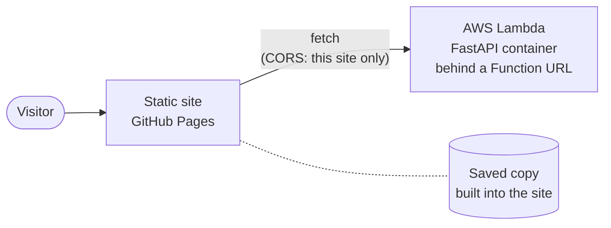
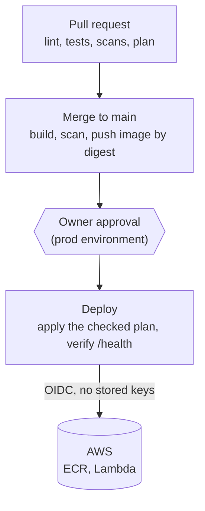

# devops-portfolio

[](https://github.com/sergo3030/devops-portfolio/actions/workflows/ci.yml)
[](https://github.com/sergo3030/devops-portfolio/actions/workflows/codeql.yml)
[](https://github.com/sergo3030/devops-portfolio/actions/workflows/synthetic.yml)
[](https://github.com/sergo3030/devops-portfolio/releases)
[](LICENSE)

A portfolio site that is **deliberately over-engineered**, because its real purpose is to show how I
build and run things: OpenTofu on AWS, keyless GitHub OIDC, a hardened CI/CD pipeline, an approval-gated
deploy by image digest, and a teardown I have rehearsed. The site itself is a CV, a timeline and a
skills filter.

**Live site:** <https://sergo3030.github.io/devops-portfolio/> (it shows "Live from API" with the
running version when the API answers, and the content saved at build time when it does not).

## What runs where

What a visitor touches:



The site works without the API: it renders the saved copy first and swaps in live data if the API
answers in time. How a change reaches production:



| Part | What | Where |
|---|---|---|
| Site | React 19, Vite, TypeScript; types generated from the content schema | GitHub Pages |
| API | FastAPI behind the Lambda Web Adapter, read-only, CORS for the site only | AWS Lambda (container image) with a Function URL, us-east-1 |
| Infrastructure | OpenTofu in three roots: `bootstrap` (state, OIDC, roles, budgets), `github` (repository settings) and `prod` (the API) | [`infra/`](infra/) |
| Pipelines | `ci`, `codeql`, `plan`, `build`, `deploy`, `release`, `pages` and a daily `synthetic` live check | [`.github/workflows/`](.github/workflows/) |

## Why you can trust it in 60 seconds

- **A green pipeline with scans.** Lint, tests, gitleaks, Checkov, CodeQL, Trivy, hadolint, zizmor and an
  end-to-end test in a real browser gate every merge. The ruleset has no bypass.
  See the [checks](https://github.com/sergo3030/devops-portfolio/actions/workflows/ci.yml).
- **No secrets, no stored cloud keys.** CI uses short-lived OIDC credentials through three narrow roles.
  [How secrets work here](docs/secrets.md), including what this does *not* protect.
- **Releases and deploys you can follow.** [v0.1.1](https://github.com/sergo3030/devops-portfolio/releases/tag/v0.1.1)
  was built, scanned, approved and verified against the running API ([how](docs/runbook-prod.md#releasing-task-15a-d42)).
- **Cost under control.** A few cents a month. A concurrency cap that was shown to throttle, and an
  emergency brake that was applied for real ([cost guards](docs/runbook-prod.md#cost-guards-and-how-each-was-tested-task-18-d47)).
- **A teardown I have rehearsed.** The destroy and recreate was run once by hand with timings in the
  runbook, and `just teardown-api`, `just teardown-aws` and `just up-prod` wrap it: each previews the
  full plans before it applies anything ([three levels](docs/runbook-prod.md#teardown-three-levels-task-18a-d48)).
- **Decisions are written down**, with the reason and the alternatives rejected:
  [decisions and plan deviations](docs/decisions.md).

## Cost, honestly

Normal use costs a few cents a month (image storage in ECR). Lambda and logs fall inside the free
allowances, and the state bucket costs a fraction of a cent. AWS has no hard spending cap, so the guards are layered: a monthly Budget
alert, a daily anomaly check, a concurrency cap of two, read-only and size-limited requests, and an
emergency brake (`reserved_concurrency = 0`). Budget emails lag by hours, so the cap and the brake
are the real protection. Details and the test results: [cost guards](docs/runbook-prod.md#cost-guards-and-how-each-was-tested-task-18-d47).

## Where to read more

| | |
|---|---|
| The API and the site | [API](docs/api.md), [site](docs/web.md), [how content is checked](docs/content.md) |
| Run it and operate it | [prod root](docs/runbook-prod.md), [bootstrap root](docs/runbook-bootstrap.md), [GitHub root](docs/runbook-github.md) |
| Why it is built this way | [decisions](docs/decisions.md), [the plan](docs/aws-lambda-baseline-plan.md) |
| Security | [how secrets work here](docs/secrets.md), [SECURITY.md](SECURITY.md) |
| Everything created by hand | [manual steps](docs/manual-steps.md), [inventory of resources](docs/inventory.md) |

## Quick start (Windows, Git Bash)

See [docs/toolchain.md](docs/toolchain.md) for the tools and how to install them.

```bash
just --list          # every task: checks, local API and site, previews of the infrastructure
pre-commit install   # secret scan and content checks before each commit
```

Docker does not run on the development machine, so container builds and the end-to-end test run in
GitHub Actions only.

## License

MIT
